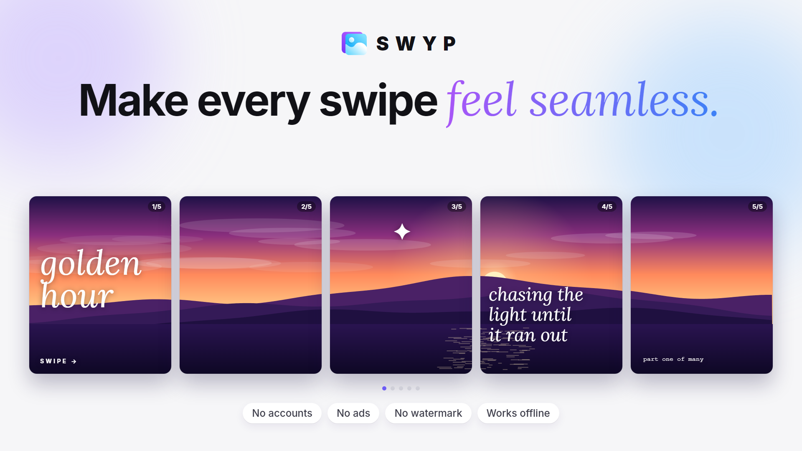
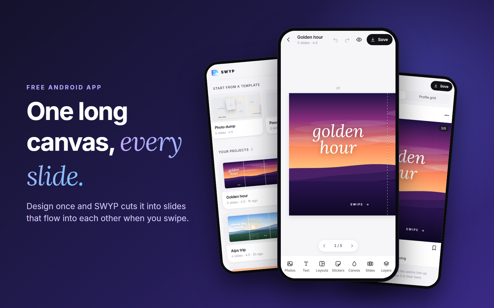

# SWYP

**Make every swipe feel seamless.**

## About

SWYP is a free Android app for making seamless Instagram carousels. Design on one long canvas, and SWYP slices it into slides that flow into each other when you swipe.

There are no accounts, no ads, no watermark and no internet permission. Your projects and photos stay on your phone.

## Features

- **Projects:** every carousel is saved automatically, and you can rename, duplicate or delete it
- **Templates:** eight starters, such as photo dump, panorama, travel diary, quote series, birthday, product launch, before and after, and mood board
- **Formats:** 4:5, 3:4, 1:1 and 9:16, from 1 to 20 slides, and you can change them at any time
- **Slides:** add, duplicate, move, clear or delete them. Panoramas stretch and shrink with the carousel.
- **Photos:** a panorama across all slides, one photo per slide, or photos placed freely
- **Editing:** move, pinch to scale and rotate, resize from the sides, and snap to slide edges, centers and seams
- **Crop and swap:** double-tap to crop, or hold a photo and drag it onto another frame to swap
- **Photo tools:** eight filters, brightness, contrast, saturation, warmth, frames, rounded corners, flip, opacity and shadow
- **Text:** eight styles and six fonts, with size, color, weight, italic, alignment, spacing, outline, curve and a highlight background
- **Stickers:** emoji, vector stickers, shapes and photo frames
- **Layouts:** ten single-slide grids and four layouts that span two slides
- **Canvas:** solid colors or gradients that run across every seam
- **Layers:** reorder, hide and lock
- **Undo and redo**
- **Preview:** an Instagram-style post you can swipe through, and a profile grid that shows how slide 1 is cropped
- **Save to gallery:** full-resolution JPG or PNG files, numbered in order. Slide 1 is saved last, so it shows first in Instagram's picker.
- **Share projects:** send a `.swyp` file with the photos included, and a friend opens it with **Import file**
- **Light and dark** appearance

## Getting started

1. Download the latest APK from the [Releases page](https://github.com/direkjames/SWYP/releases/latest) on your phone.
2. Open the file. The first time, Android asks you to allow installs from the app you opened it with.
3. Open SWYP and press **New carousel**, or start from a template.
4. Add your photos and text, then press **Preview** to check the seams.
5. Press **Save** to put the slides in your gallery, then post them in Instagram.

## Requirements

- An Android phone with Android 10 or newer

## Built with

- Kotlin, with the editor itself written in plain HTML, CSS and JavaScript inside the app
- Gradle and GitHub Actions for the builds

Want to build it yourself? See [Developing SWYP](docs/DEVELOPING.md).

## Status

Shipped.

## Credits / License

Made by [direkjames](https://github.com/direkjames). See [LICENSE](LICENSE). The bundled fonts keep their own licenses (see `app/src/main/assets/www/fonts/LICENSES.txt`).
